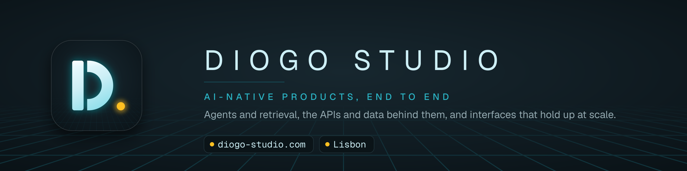

Diogo Studio is the home of [Diogo Esteves](https://github.com/dgesteves)'s independent work. Diogo is a Staff Full-Stack AI Engineer in Lisbon who builds AI-native products end to end: agents and retrieval, the APIs and data behind them, and interfaces that hold up at millions of users.

- **Website:** [diogo-studio.com](https://diogo-studio.com): work, case studies, writing and résumé
- **Open source:** [onagents](https://github.com/onagents): [onsystem](https://github.com/dgesteves/onsystem), [ondocs](https://github.com/dgesteves/ondocs) and [signoff-ui](https://github.com/dgesteves/signoff-ui)
- **Now:** [what Diogo is working on](https://diogo-studio.com/now)
- **Contact:** [diogo-studio.com/contact](https://diogo-studio.com/contact)
